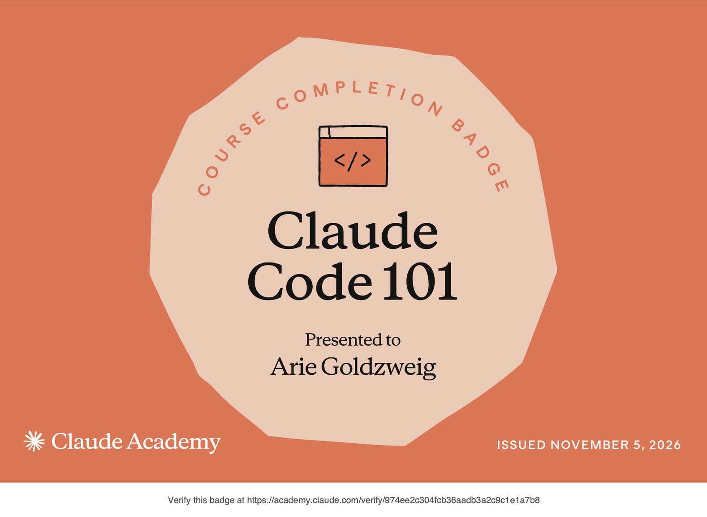

# Certificaciones de Claude Code

Llena este archivo en **tu copia**, dentro de `estudiantes/<tu-login>/claude_code/`.

## Quién soy 

- Usuario de GitHub: goldzweigarie-bit

El repositorio es público: no escribas aquí tu nombre completo ni tu correo.

## Claude Code 101

Fecha en que lo terminaste (AAAA-MM-DD): 2026-11-05

URL del badge de Claude Academy: https://academy.claude.com/verify/974ee2c304fcb36aadb3a2c9c1e1a7b8

Si no terminaste el curso, dilo aquí abajo: qué lecciones o qué parte del
quiz te faltaron. Reportar el pendiente cuenta como entrega.

## Una cosa que aprendiste y no sabías

Se llena en esta entrega. Dos o tres líneas: algo concreto del curso que no
sabías, o que tenías a medias y ahí se te acomodó.

Aprendí que un agente de programación como Claude Code no solo responde preguntas como un chat, sino que ejecuta un flujo de cuatro fases (explorar, planear, programar y hacer commit) para entender el contexto del repositorio antes de escribir código. También entendí que el archivo CLAUDE.md sirve para darle instrucciones persistentes y personalizadas al agente sobre cómo debe comportarse en este proyecto específico.
